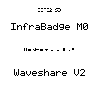
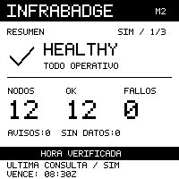
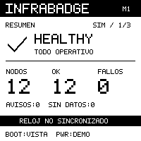

# InfraBadge — M2 Wi-Fi / HTTPS (en desarrollo)

InfraBadge es un dispositivo open source de monitoreo de infraestructura sobre
**Waveshare ESP32-S3-ePaper-1.54 V2**. M0 prepara y compila pruebas de hardware:
pantalla, batería/RTC/SHTC3 y un ciclo de deep sleep, sin red. M2 añade un perfil
separado de Wi-Fi/HTTPS con datos simulados; no incluye MQTT ni Prometheus.

Este repositorio es **jnbntc/infrabadge**. `jnbntc/distrobox-stack` sigue administrando
exclusivamente el entorno de desarrollo. No se flashea hardware automáticamente.



## M2: conectividad de laboratorio

Perfil separado: STA → HTTPS con CA/hostname/fechas → snapshot validado → pantalla
condicional → deep sleep. Gateway FastAPI/Pydantic con estados simulados, tokens
individuales y ETag/304. Sin collectors de producción, MQTT ni base de datos.
La placa conserva el **diagnóstico autónomo M2 SHA93277e2e, con corrección401**, cuyo grupo final está en marcha; los intentos anteriores conservan su estado
incompleto. No hay PASS del grupo hasta validar su journal terminal.
Con la aplicación anterior SHA733f7b9b se confirmaron
físicamente HTTPS200/pantalla, consulta autónoma ETag/304, cuatro estados y
recuperación tras HTTP503. Las excepciones temporales de ruta se retiraron.
El intento interrumpido registró un wake reset8/wake4; falta completar los25
del grupo. M2 sigue en validación: cancelación de refresco, negativos
TLS físicos, batería y consumo pendientes. Ver el informe físico; no repetir
cargas/provisiones ni ventanas de red con autorizaciones ya consumidas.

M1.1 se propone por separado en [PR #2](https://github.com/jnbntc/infrabadge/pull/2),
base main; M2 parte de esa misma base estable y usa feat/m2-connectivity.
M2 se propone en [PR #3](https://github.com/jnbntc/infrabadge/pull/3), basado en #2.
Ninguna rama anterior se reescribió y no se fusionó nada automáticamente.

```sh
bash tools/build-m2.sh --all  # seis perfiles + tests C/sanitizadores/visuales; no hardware
# Backend independiente, sin instalar nada en el SDK:
python3 -m venv /tmp/infrabadge-gateway
/tmp/infrabadge-gateway/bin/python -m pip install --require-hashes -r gateway/requirements.lock
/tmp/infrabadge-gateway/bin/python -m pytest -q gateway/tests
/tmp/infrabadge-gateway/bin/python tools/m2/generate_protocol.py --check
```

Se necesita hora UTC inicial desde un host físico confiable para validar TLS.
Reset frío o pérdida de continuidad exige renovarla por USB. La NVS no está
cifrada; no se promete resistencia a extracción física. No hay credenciales
compiladas ni TLS sin validación. El RTC externo2056 continúa excluido.

- [Arquitectura y ramas M2](docs/M2-DESIGN.md).
- [Contrato, gateway, provisión y rotación](docs/M2-API.md).
- [Seguridad y límites de confianza](docs/SECURITY.md).
- [Resultados M2](docs/M2-VALIDATION.md).
- [Evidencia física M2 y límites](docs/M2-PHYSICAL-RESULTS.md).
- [Estados y recuperación HTTP: sesión confirmada](docs/M2-SCENARIOS.md).
- [Automatización M2: perfil compilado y límites del ensayo autónomo](docs/M2-AUTOMATION.md).
- [Diagnóstico autónomo M2: procedimiento y autorización](docs/M2-AUTO-DIAGNOSTIC.md).
- [Procedimiento físico; nuevos ensayos requieren autorización](docs/M2-PHYSICAL.md).
- [Impacto energético esperado, sin mediciones](docs/POWER.md).

Captura SINTÉTICA generada por el mismo renderizador C (no prueba de hardware):



## Estado

El [PR #1](https://github.com/jnbntc/infrabadge/pull/1) fue fusionado con M1.
M1.1 y la documentación conjunta se publicaron después en `feat/m1-ui` y siguen
fuera de ese merge. [El informe consolidado](docs/M1-M11-VALIDATION.md)
distingue tests/CI, validación M1 por USB, tres retornos M1.1 sólo con batería y
mediciones pendientes. Ese informe conserva el cierre histórico de M1.1; el
firmware instalado cambió después a M2 en los ensayos autorizados descritos arriba.
Por elección del usuario, #1 conserva la evidencia complementaria y no se abrió
otro PR para los cambios de la rama.

La matriz de conexiones se contrastó con el esquemático oficial N8R8 y los ejemplos
ESP-IDF **V2**. [HARDWARE.md](docs/HARDWARE.md) documenta señales, polaridades,
referencias fijadas y los límites del esquemático compartido con la variante Touch.
Los tres perfiles M0 compilaron y pasaron los tests sin hardware. Se validaron
físicamente pantalla, lecturas RTC/SHTC3, ADC, botones y un ciclo de deep sleep con
retorno por temporizador y reconexión USB. La fecha del RTC es incorrecta y no se
modificó. Consumo y precisión del ADC siguen pendientes; M1.1 confirmó posteriormente
tres retornos por timer sólo con batería, como se detalla más abajo.
Ver [el informe físico y sus límites](docs/PHYSICAL.md). Los binarios antiguos de
la prueba anterior no deben flashearse.

## Interfaz M1

M1 añade tres vistas offline (resumen, alertas y diagnóstico), cuatro estados
HEALTHY/WARNING/CRITICAL/OFFLINE y navegación por BOOT/PWR. Los datos son simulados;
el RTC se declara no sincronizado y no se modifica. Se reutilizan HAL y protocolo
M0, sin añadir dependencias gráficas, radios ni red. **La validación funcional M1 por USB está cerrada:**
12 pantallas, navegación, reposo y retorno de deep sleep por timer/BOOT/PWR.
Consumo y otras pruebas dirigidas siguen pendientes. La prueba posterior M1.1
cerró tres retornos por timer sólo con batería, con su perfil de diagnóstico.

- [Arquitectura, controles y decisiones de energía](docs/UI.md).
- [Galería de 12 capturas simuladas](docs/ui/index.html).
- [Resultados M1](docs/M1-VALIDATION.md).
- [Evidencia física y pendientes](docs/M1-PHYSICAL-RESULTS.md).
- [Procedimiento físico y carga manual](docs/M1-PHYSICAL.md).



```bash
# Tests, regresiones de los tres perfiles M0 y compilación M1; sin tocar la placa:
bash /var/home/juanb/Proyectos/infrabadge/tools/build-m1.sh --all
# Sólo M1, manteniendo los tests nativos y visuales:
bash /var/home/juanb/Proyectos/infrabadge/tools/build-m1.sh
```

El binario M1 se genera en `build-m1/ui/infrabadge.bin`; no es una imagen fusionada:
la carga manual necesita también el bootloader y la tabla de su mismo build.
BOOT corto cambia de vista; PWR corto cambia de escenario; PWR mantenido ≥1,2 s
**y soltado** solicita deep sleep. Hay espera entre refrescos completos, sin envíos
si el framebuffer no cambió. El panel es síncrono: esperar el refresco antes de pulsar.
Dormido, los botones despiertan; no navegan hasta soltar y volver a pulsar.

## Diagnóstico M1.1 de timer con batería

Perfil temporal separado: inicio manual con BOOT tras retirar USB, tres deep sleeps
de 60 s, contador en RTC RAM y resultado terminal sin cuarto ciclo. Sólo cuentan
retornos con reset de deep sleep, causa TIMER y registro íntegro previamente armado.
El HAL y el driver del panel se reutilizan; la UI M1 conserva sus controles.

El usuario confirmó encendido y ambos botones sólo con batería LiPo AT 502535
(3,7 V / 400 mAh nominales; 4,03 V medidos en circuito abierto). Los tres retornos
autónomos **están confirmados funcionalmente**: el operador observó un RUN 0/3
nuevo y 1/3 → 2/3 → PASS 3/3 sólo con batería, sin USB ni intervención, con
RESET:8 / WAKE:4 comunicados en el resultado. M1.1 fue cargado con autorización
para esta prueba temporal; reemplazó M1 y permanece instalado. No se realizó
restauración de M1 ni de fábrica. Consumo y autonomía siguen sin medirse.

```bash
bash tools/build-timer.sh --all  # tests, tres perfiles M0, M1 UI y diagnóstico timer
```

Artefactos del diagnóstico: `build-m11/timer/`. [POWER-BASELINE.md](docs/POWER-BASELINE.md)
incluye diseño, simulaciones, pruebas, cierre físico y procedimiento de carga
controlada. Cualquier otra carga requiere autorización explícita nueva. Un PASS
dibujado por el simulador o una imagen retenida no es evidencia física de la secuencia.

## Entorno fijado

- ESP-IDF **v5.5.5**, commit `b774170ff46c393eeb5e495ea37936038d3f4f4f`.
- ESP32-S3, flash 8 MB, consola USB Serial/JTAG; PSRAM no utilizada en M0.
- Imagen de `iot-dev` fijada por digest en `dependencies.lock.json`.
- No se instalan toolchains en Fedora. No hay componentes externos descargados
  por IDF Component Manager; sólo drivers IDF y el protocolo mínimo de pantalla.
- Avisos de terceros: [THIRD_PARTY.md](THIRD_PARTY.md).

## Compilación

Desde la carpeta local del host, usando el `iot-dev` Distrobox ya preparado:

```bash
bash /var/home/juanb/Proyectos/infrabadge/tools/build.sh all
```

Dentro de un shell ESP-IDF ya activado se usa el mismo script, sin Distrobox:

```bash
cd /workspace/projects/infrabadge  # si se trabaja en el volumen persistente
bash tools/build.sh all
```

El launcher externo `distrobox-stack/scripts/iot-idf` expone el puerto como
`/dev/infrabadge`, define ESPPORT y conserva `/workspace/projects` en un volumen.
Ese volumen es independiente de `~/Proyectos`: requiere tener allí una copia de
este proyecto; el launcher no monta automáticamente la carpeta del host. Si su
imagen por defecto no coincide, definir IDF_IMAGE con el digest de `dependencies.lock.json`.
El build puede ejecutarse sin hardware; el launcher USB necesita una placa para
abrir su sesión, pero los tests y compilaciones dentro del entorno no la utilizan.

Perfiles:

| Perfil | Prueba preparada | Comando |
| --- | --- | --- |
| display | Texto exacto **InfraBadge M0**, refresco único y apagado del panel | `bash tools/build.sh display` |
| sensors | Cinco lecturas de batería, RTC sin escritura, SHTC3/CRC y botones | `bash tools/build.sh sensors` |
| sleep | Pantalla, espera, deep sleep 10 s o BOOT/PWR y log del retorno; un solo ciclo | `bash tools/build.sh sleep` |

Artefactos: `build-m0/PERFIL/`; configuraciones separadas por perfil. Resultados y
hashes: `results/m0-build-FECHA-SUFIJO/`. El script exige el commit SDK fijado,
ejecuta los tests y verifica ELF Xtensa, perfil, flash, consola, seguridad y
cierre de dependencias sin radios. No abre puertos ni escribe la placa.

Para ajustar la duración del modo sleep o el wake por botones, usar menuconfig
sobre **su** directorio de build. Las configuraciones deliberadamente modificadas
deben revisarse antes de autorizar un binario; no reutilizar perfiles intercambiados.

## Tests sin hardware

Dentro del contenedor, con compilador C nativo y Python disponibles:

```bash
bash tools/test.sh
IB_SANITIZE=1 bash tools/test.sh  # AddressSanitizer + UndefinedBehaviorSanitizer
```

Incluyen validación de recursos y exclusión de artefactos privados; C nativo para
BCD/calendario/12–24 h y OS/STOP del RTC, CRC SHTC3 y conversión, divisor de batería,
límites del renderer y comparación de los 5000 bytes contra una imagen de referencia.
El protocolo e-paper se prueba con HAL simulado: único refresco/reposo, errores de
SPI, timeout BUSY y limpieza. Esa simulación no valida GPIO, niveles ni pantalla real.

Para regenerar la simulación y recursos versionados:

```bash
python3 tools/generate_screen.py
python3 tools/generate_screen.py --check
```

El workflow `.github/workflows/m0.yml` conserva los tres perfiles M0, M1 y M1.1 y añade M2 con
imagen/acciones fijadas, red deshabilitada durante el build y sin dispositivos.
La [ejecución por push de M1](https://github.com/jnbntc/infrabadge/actions/runs/39060431040)
pasó el 17 de octubre de 2026. M1 se fusionó mediante el
[PR #1](https://github.com/jnbntc/infrabadge/pull/1), con validación funcional física
cerrada; M1.1 se publicó posteriormente y todavía no está integrado en `main`.
Los límites y mediciones pendientes están en el informe físico.
El estado de CI de la revisión consolidada se consulta en las ejecuciones de Actions
de `feat/m1-ui` para el SHA correspondiente;
la ejecución histórica M1 no sustituye la validación de la revisión vigente.

El PNG se compara por píxeles descomprimidos, no por su flujo de compresión zlib.
La imagen es una simulación del diseño, no una captura de la placa.

## Documentación y límites

- [Arquitectura y contratos](docs/ARCHITECTURE.md).
- [Alimentación, ADC y deep sleep](docs/POWER.md).
- [Flashing manual, monitor y rollback](docs/FLASHING.md).
- [Validación consolidada M1 + M1.1](docs/M1-M11-VALIDATION.md).
- [Resultados históricos M0](docs/VALIDATION.md).
- [Reglas para agentes](AGENTS.md).

El backup privado de fábrica queda fuera de Git y CI. Se cargaron los tres perfiles
M0 tras autorización explícita del usuario. Después se cargó M1 y, para el diagnóstico
actual, M1.1 con autorización nueva; fábrica no se restauró. No se ejecutaron borrado completo, escrituras de eFuses ni
cambios de Secure Boot/Flash Encryption. Las nuevas escrituras requieren autorización. La licencia general del código
original se elegirá antes de publicar; los avisos Waveshare ya están preservados.
