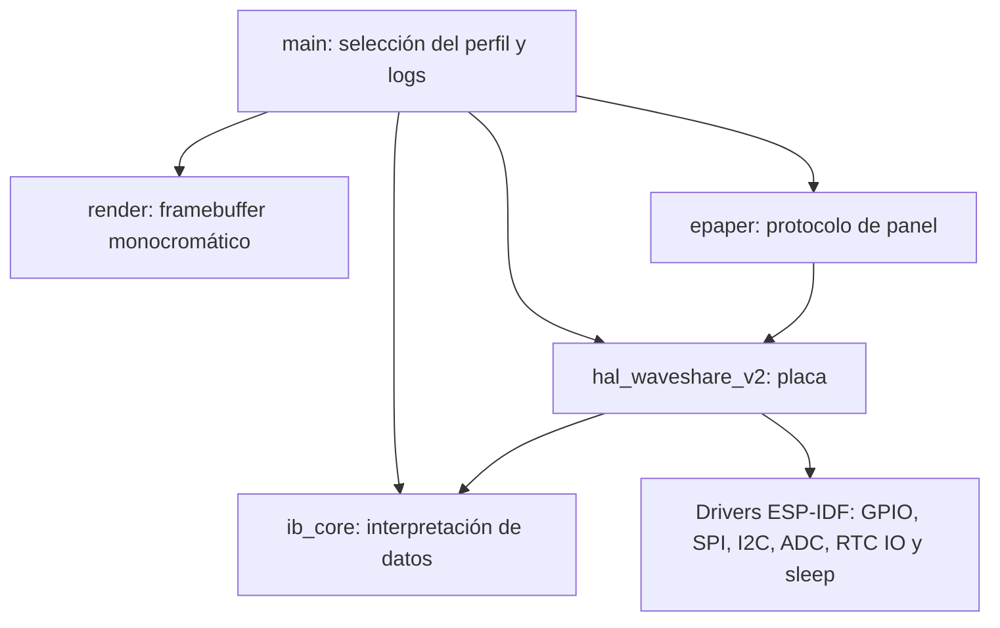

# Arquitectura M0

El perfil temporal M1.1 añade `timer_diag` (estado RTC y renderizador portables) y
`main/timer_diag_main.c` (orquestación). Reutiliza HAL/panel sin cambios y amplía el
Power Manager con una opción timer exclusivo; la API usada por M1 mantiene wake
por botones. Selección, invariantes y límites: [POWER-BASELINE.md](POWER-BASELINE.md).

M0 valida el acceso básico a hardware; no incluye red, gateway, MQTT ni Prometheus.
ESP-IDF nativo y CMake, objetivo `esp32s3`, SDK 5.5.5 fijado por commit.

| Módulo | Responsabilidad | Dependencias |
| --- | --- | --- |
| `main` | Orquestar una prueba, registrar errores, decidir cuándo dormir | HAL, epaper, render, core, ESP-IDF |
| `render` | Fuente original 5×7, texto exacto InfraBadge M0 y borde, buffer MSB-first | C estándar; recursos generados y versionados |
| `ib_core` | BCD/calendario RTC, 12/24 h, OS/STOP, CRC SHTC3 y escala del divisor | C estándar, sin hardware |
| `epaper` | Inicialización y waveform, refresco completo único, reposo del panel | Interfaz HAL; aviso Waveshare preservado |
| `hal_waveshare_v2` | Todos los GPIO, polaridades, SPI/I²C, ADC calibrado y retención de alimentación | Drivers ESP-IDF, core |

Sólo el HAL asigna GPIO. `ib_board_pins.h` es el mapa de placa; no se copian números
GPIO en la aplicación ni en el renderer. El driver de panel no contiene detalles
de GPIO/SPI de ESP-IDF. Los tests nativos de protocolo usan un HAL simulado;
las compilaciones de firmware usan exclusivamente el HAL real y los headers IDF.

## Perfiles separados

- **display**: renderiza 5000 bytes, transmite una vez, duerme y apaga el panel.
- **sensors**: cinco muestras, separadas por dos segundos; batería, RTC de sólo
  lectura, SHTC3 con CRC y estado de botones. No actualiza la pantalla.
- **sleep**: muestra la pantalla, espera cinco segundos, duerme diez segundos o
  hasta BOOT/PWR, registra la causa al despertar y termina la prueba sin otro ciclo.

Cada perfil tiene su propio `build-m0/PERFIL/sdkconfig` y artefactos. No reutiliza
el sdkconfig de la prueba anterior. `Kconfig.projbuild` define una elección exclusiva.
La PSRAM permanece desactivada. CMake construye `main` y el cierre de dependencias
necesarias; el verificador rechaza Wi-Fi/Bluetooth/MQTT/OpenThread en ese cierre.

## Contratos y fallos

- No hay mutex ni concurrencia entre periféricos en M0; HAL y epaper no son reentrantes.
- Transacciones I²C con timeout de 100 ms; BUSY e-paper con timeout de 30 s.
- El HAL habilita PAVCC durante el acceso I²C y la apaga al cerrar el bus; el códec
  comparte SDA/SCL. Se habilitan pull-ups internos como en el ejemplo oficial V2.
  Esto no inicializa audio. La secuencia corrigió el bloqueo observado en placa.
- Ante error de panel se libera SPI y se intenta cortar alimentación; no se refresca
  de nuevo en un bucle ni se entra en deep sleep tras un error de pantalla.
- Se propagan los errores de los drivers; no se imprime una medición no obtenida.
- El RTC se lee en una sola ráfaga coherente de registros 0x00–0x0A; sólo se escribe
  el índice de lectura I²C, nunca fecha, alarmas, offset ni bits de control.
- OS, STOP/test, BCD inválido o fechas imposibles producen estado no confiable.
  Los años se interpretan explícitamente como 2000–2099; no se supone zona horaria.
- El SHTC3 recibe wake/medición/sleep, sin soft reset; se verifican ambos CRC.
- La tensión requiere calibración ADC válida. No hay fórmula inventada si falta,
  ni cálculo de porcentaje de batería.
- Logs por USB Serial/JTAG sin identificadores privados, MAC, SSID o credenciales.

## Dependencias y licencia

No hay componentes gestionados descargados por IDF Component Manager. SDK, imagen
de entorno y referencia Waveshare quedan fijados en `dependencies.lock.json` y
`docs/upstream.json`. `THIRD_PARTY.md` identifica el material de terceros.
Los recursos de pantalla se regeneran con Python estándar y se validan sin red.

## Extensión M1

La arquitectura UI nueva y sus contratos están en [UI.md](UI.md). M0 conserva sus
perfiles originales; la selección M1 utiliza una entrada de aplicación separada.

## Extensión M2: ciclo conectado separado

La entrada `main/m2_main.c` usa componentes nuevos `connectivity_core`,
`device_config`, `wifi_manager`, `https_client` y `connectivity_ui`. Conserva los
archivos originales de HAL, e-paper, Power Manager, UI M1 y diagnóstico M1.1.
[Diseño y ramas](M2-DESIGN.md), [contrato](M2-API.md), [seguridad](SECURITY.md).

El perfil exclusivo `IB_M2_CONNECTIVITY` necesita además `-DIB_BUILD_M2=ON` en
un directorio propio. Esa selección se pasa como propiedad de build a la expansión
temprana de CMake/IDF: CONFIG_* todavía no está disponible allí. Los cinco perfiles
anteriores mantienen fuera su cierre de dependencias radio/HTTP. El verificador
inspecciona configuración, arquitectura ELF, símbolos y offsets de cada perfil.
Sólo M2 admite Wi-Fi; Bluetooth/MQTT permanecen excluidos en todos.

El core portable recibe puertos de conexión, fetch, reloj, persistencia, render,
apagado y sueño. Por eso las pruebas inyectan fallos sin abrir sockets Wi-Fi ni
invocar deep sleep real. El adaptador de display llama al renderer M1 intacto y
sustituye sólo etiquetas M2, reloj y semántica de datos históricos. No utiliza
valores simulados como diagnósticos físicos del dispositivo.

Caché de snapshot versionada en NVS ligada al CRC de configuración, con último
estado bueno y ETag. Caché de framebuffer exacto de 5000 bytes en RTC RAM con CRC,
aceptada sólo al volver de deep sleep con la misma configuración. Comparación por
bytes, sin depender únicamente de hash. Un reset frío invalida framebuffer y hora;
la copia NVS sigue siendo histórica hasta validar tiempo y consulta.
No se añade escritura NVS por cada 304 ni por snapshot semánticamente idéntico.
No hay refresco parcial ni nueva pila gráfica; PSRAM sigue desactivada.

Wi-Fi STA usa credenciales RAM del driver, tres intentos como máximo y backoff
1/2 s dentro del presupuesto configurado (1000..15000 ms desde driver iniciado).
HTTPS nativo asíncrono usa CA explícita y controles de hostname/fecha. Presupuesto
1000..10000 ms, body ≤2048, sin redirects. Una tarea guardia interrumpe el socket
activo al vencer el plazo; su propietario la detiene y espera antes de liberar
cliente/contexto. No se utiliza el retorno del callback HTTP como supuesto abort.
DNS antes de tener socket conserva los reintentos finitos de lwIP: no se afirma
que ese tramo esté incluido en un deadline estricto de pared. Inicialización SDK,
DNS y limpieza requieren medición física; no se promete WCET de todo el ciclo.

Todos los resultados de red pasan por render condicional → parada Wi-Fi → Power
Manager. Fallo del panel/HAL o negativa a dormir dejan radio apagada y aplicación
detenida, sin reconexión continua. Los botones pueden despertar mediante M1; M2
realiza una consulta por wake y no ejecuta el navegador interactivo de M1.
