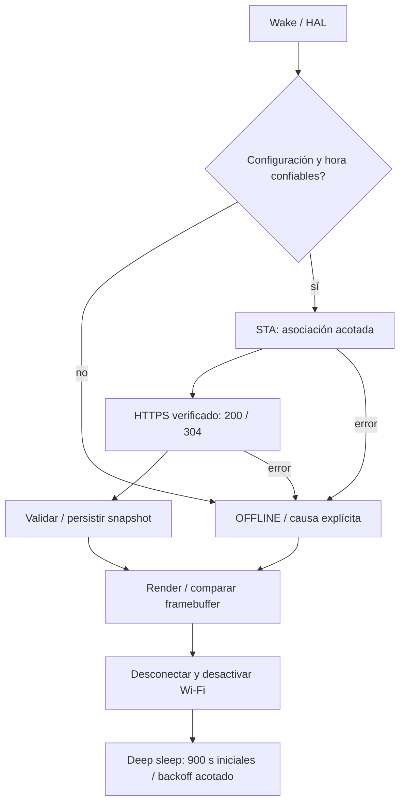

# M2 — diseño previo a implementación

## Base y dependencia

Inspección inicial: `origin/main` = `be7330d` (merge M1), `feat/m1-ui` = `b2dcf7a`.
Los cinco commits exclusivos son `a1c7294`, `8f4193c`, `005740e`, `a9a5302` y
`b2dcf7a`. Incluyen el Power Manager extendido, diagnóstico M1.1 y documentos;
ningún commit M1 se duplica. `feat/m1.1-integration` conserva ese árbol en
[PR #2](https://github.com/jnbntc/infrabadge/pull/2), base `main`, en borrador.
No se reescribió ni eliminó `feat/m1-ui`; no se fusionó nada.

`feat/m2-connectivity` parte de `b2dcf7a`, base validada por CI y por las pruebas
M1.1 documentadas. El [PR M2 #3](https://github.com/jnbntc/infrabadge/pull/3) tiene como base
la rama de integración mientras #2 está pendiente: así su diff muestra únicamente M2. La integración de #2 en main
seguirá siendo una decisión humana. La placa conserva M1.1 y no se tocará aquí.

## Contrato primero

`GET /api/v1/devices/{device_id}/status`: HTTPS, Bearer individual, JSON versión 1,
timestamps enteros Unix UTC, revisión, estado, contadores, hasta dos alertas ASCII,
`simulated=true`, ETag fuerte SHA-256 y `If-None-Match`. Respuesta máxima 2048 bytes.
304 sólo reutiliza una copia local todavía vigente; nunca prolonga su expiración.
El gateway regenera snapshots vencidos antes de comparar ETag. JSON, rangos,
consistencia de estado/contadores, identidad, vigencia y regresión de fecha se
validan antes de reemplazar el último snapshot válido.

## Módulos

| Módulo | Responsabilidad |
| --- | --- |
| connectivity_core | Contrato portable, snapshot, frescura, errores, backoff y ciclo con puertos simulables |
| wifi_manager | STA, credenciales sólo RAM del driver, presupuesto y reintentos acotados, parada explícita |
| https_client | esp_http_client, CA/hostname/fecha, límites, ETag, sin redirects ni bypass TLS |
| device_config | Aprovisionamiento USB con presencia física, NVS y último snapshot; sin borrados automáticos |
| connectivity_ui | Adaptador del renderer M1; marca simulación, reloj y fallos sin presentar salud antigua como actual |
| Power Manager existente | Preparar alimentación/HOLD y deep sleep; diagnóstico M1.1 permanece separado |
| gateway Python | FastAPI/Pydantic, fixtures deterministas, autenticación y pruebas HTTPS sin hardware |

## Hora y credenciales

El primer UTC se aporta por USB desde un host físicamente confiable durante el
aprovisionamiento. Un registro RTC íntegro y un retorno real de deep sleep conservan
la confianza durante una ventana limitada; NVS no convierte una fecha guardada en
hora actual. Cada respuesta HTTPS válida puede renovar el ancla con el reloj del
gateway, con salto máximo acotado. Reset no esperado, pérdida de alimentación,
retroceso o vencimiento de la ventana exigen volver a aportar hora por USB.
No se usa SNTP ni el PCF85063 para desbloquear TLS. El coste de esta estrategia de
laboratorio es perder disponibilidad hasta una nueva sincronización física en esos
casos. Ver [SECURITY.md](SECURITY.md).

## Límites previstos

No hay mediciones de consumo ni validación Wi-Fi/TLS en la placa durante M2.
La CA y los secretos se aprovisionan en ejecución, sin claves privadas compiladas.
NVS sigue sin cifrar porque no se cambian eFuses ni seguridad de arranque: el acceso
físico a flash puede extraer/modificar credenciales. Este límite impide presentar
M2 como un diseño de producción resistente a extracción física.
