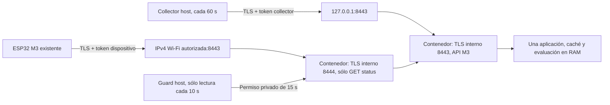

# M3.1 — operación LAN propuesta

Estado: candidato de software, **no desplegado**. Fecha de preparación: 2026-10-21.
M3 se integró con autorización mediante [PR #4](https://github.com/jnbntc/infrabadge/pull/4),
merge `df11e98a8514e1262ce2aaa27378c0249033c84d`;
[CI del merge](https://github.com/jnbntc/infrabadge/actions/runs/39342160696) aprobada.
La rama M3 se conservó. M3.1 parte de ese main en `feat/m3.1-lan-deployment`.

## Un backend y dos entradas

`lan_server.py` ejecuta dos servidores Uvicorn en un único proceso/event loop;
ambos comparten exactamente la aplicación M3. No se añade proxy, base de datos,
worker múltiple ni una segunda caché. El cierre/fallo de un servidor detiene ambos.
La entrada local conserva ingreso y consulta M3; la LAN admite exclusivamente
`GET /api/v1/devices/{device_id}/status` de dispositivos reales configurados.
No admite ingreso de collectors, documentación, parámetros de fallo ni WebSocket.

El contenedor publica dos puertos con direcciones **explícitas del host**.
`0.0.0.0` sólo existe dentro del namespace aislado para recibir las publicaciones;
no se usa host networking ni publicación wildcard del host. No se confía en
cabeceras proxy. Se conserva el nombre de unidad/contenedor M3 para reemplazar
el backend en una futura instalación, sin duplicarlo. El collector no cambia.

El contrato, serializer, autenticación, ETag, TTL y evaluación son los existentes.
Una muestra caducada produce UNKNOWN/REAL; nunca prolongar su vigencia por GET/304.
Un reinicio pierde muestra, caché, histéresis y antireplay: UNKNOWN hasta una nueva
muestra válida. M3.1 no cambia firmware, framebuffer diff, HAL, Power Manager o NVS.

## Política y permiso temporal

`LanPolicy` fija IPv4 RFC1918, interfaz, prefijo, UUID de conexión NetworkManager,
hash SSID, zona/hash de firewall revisados, hostname SAN, imagen por ID inmutable
y lista finita de dispositivos. El ejemplo público es completamente ficticio.
El preparador sólo renderiza un directorio privado nuevo fuera del repositorio;
no instala ni ejecuta sus propuestas de red.

El guard stdlib corre **en el host**, sin root ni privilegios de escritura de red.
Comprueba dirección/prefijo/UP, perfil y SSID, zona/configuración firewalld,
ausencia de un permiso explícito amplio TCP8443, regla exacta origen-subred y
destino-IP/32, ruta de retorno y resolución del hostname. Para `.local` consulta
Avahi indicando interfaz; para DNS normal exige la IPv4 configurada. Un fallo,
falta de permisos/herramientas o deadline excedido deniega acceso LAN.

Cada ejecución tiene deadline de 7 s y comandos de hasta 2 s. Publica atómicamente
un permiso privado ligado al hash de política y a CLOCK_BOOTTIME por 15 s.
La entrada LAN lo valida antes de atender y antes de enviar cabeceras. El reloj
incluye suspensión; no se reutiliza un permiso viejo al despertar. El timer
de 10 s no despierta la notebook ni acumula ejecuciones. Su coste real está pendiente.

Esto **no es un firewall atómico por interfaz**. Después de cambiar de red puede
subsistir un permiso hasta 15 s desde la observación; el handshake TLS continúa
si hay socket publicado, y no se retiran bytes ya enviados. La publicación a IP
exacta y el firewall ligado al perfil autorizado son la barrera primaria. La
ruta se comprueba contra un peer representativo, no todos los clientes/políticas.
Un hash de reglas sólo fija una configuración previamente revisada: no demuestra
por sí mismo su seguridad ni cubre reglas globales/otras zonas/router/forwarding.

## Dirección, suspensión y sesión

Preferir reserva DHCP y hostname estable; no fijar IP estática en Fedora
automáticamente. Un cambio de IPv4 no provoca rebind ni apertura global: el guard
deniega y se prepara una nueva política/publicación revisada. Igual nombre de SSID
no acredita una red confiable; combinar perfil, interfaz, firewall, TLS y revisión.

Al suspender no hay métricas/consultas atendidas. Al volver, guard fresco y siguiente
muestra del collector restablecen servicio; la caducidad existente protege datos.
Después de logout la vida del manager de usuario depende de sesiones/linger;
sin linger no se promete operación desatendida. No se habilita linger. Reset frío
del ESP32 pierde confianza UTC y puede exigir provisión USB aparte, nunca NTP/TLS
inseguro. No se atribuye una reconexión HTTP a una causa de wake concreta.

## Archivos y observabilidad

- `gateway/infrabadge_gateway/lan_{policy,guard,edge,server,telemetry}.py`.
- `deploy/m31/`: Containerfile fijado, tres unidades candidatas y política ficticia.
- `tools/m31/`: bundle determinista, validación y vista privada de estado.
- Hooks opcionales de telemetría en `app.py`; el entrypoint normal M3 no cambia.

Telemetría agregada en `%t/infrabadge-lan-telemetry/state.json`: arranques, muestras
aceptadas/antigüedad, consultas autenticadas, respuestas, denegaciones y errores.
No guarda identidad, IP, token, cabeceras ni métricas. Es volátil y acotada; una
consulta atribuida a credencial no prueba que sea físicamente el ESP32. Un archivo
viejo no prueba disponibilidad: combinar con estado systemd y cliente TLS local.

Referencias: [Quadlet y publicación de puertos](https://docs.podman.io/en/latest/markdown/podman-systemd.unit.5.html),
[timers systemd](https://www.freedesktop.org/software/systemd/man/latest/systemd.timer.html).
Despliegue/rollback: [LAN-SETUP](M3.1-LAN-SETUP.md). Límites: [SECURITY](M3.1-SECURITY.md).
