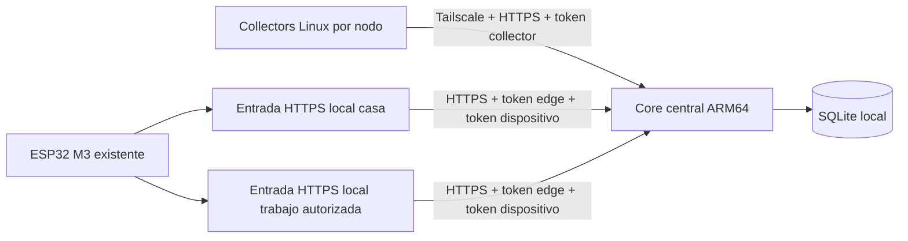

# M3.2 — núcleo distribuido

Candidato sin desplegar. Base explícita: main `df11e98a8514e1262ce2aaa27378c0249033c84d`.
Rama `feat/m3.2-distributed-core`. [PR5](https://github.com/jnbntc/infrabadge/pull/5)
se mantiene separado, draft y sin modificar; sus dos commits no son ancestros de
M3.2. La auditoría verificó sus cuatro checks aprobados. No es requisito fusionarlo
para probar este núcleo.

## Flujo y reutilización

Un núcleo autoritativo, un proceso/worker y una base SQLite local. No replicación,
descubrimiento, SSH, ejecuciones remotas, MQTT o acceso administrativo. Reutiliza
`Metrics`, `Policy`, `Evaluation`, `Snapshot`, autenticación y parser JSON M3.
El collector sigue siendo stdlib, host-native, oneshot y sin root; ahora admite
CPU thermal explícito de Linux ARM y un segundo intento de red opt-in dentro de
un único deadline. Sin cambio de configuración, M3 conserva una sola entrega.

Del diseño M3.1 se reutilizan la entrada de sólo lectura, presupuestos finitos,
cabeceras acotadas y publicación exacta rootless. El pequeño token bucket está
adaptado y sincronizado para threads. No se copió su historia ni se importó su
servidor de dos listeners/caché en RAM: un edge remoto no debe crear otra fuente
de métricas. Su guard de red puede adaptarse durante el despliegue local; las
plantillas M3.2 no lo instalan ni prometen su aislamiento. El preflight de cada
sitio y las denegaciones de otras interfaces siguen siendo gates obligatorios.

## Autenticación y API

| Ruta | Identidad autorizada | Función |
| --- | --- | --- |
| POST `/api/v1/collectors/{node_id}/metrics` | Collector específico de ese nodo | Contrato y ACK M3; sitio asignado por servidor |
| GET `/api/v1/sites/{site_id}/nodes` | Reader con ese sitio en su scope | Inventario tipado y estado histórico/fresco |
| GET `/api/v1/devices/{device_id}/status` en core | Dispositivo + edge autorizado para ese dispositivo | Snapshot M2 agregado y ETag/304 |
| Misma ruta de dispositivo en entrada local | Bearer del ESP32 | Reenvío a origen HTTPS fijo; añade su propia credencial edge |

Tokens/digests son únicos entre todos los roles, nunca se guardan en SQLite.
`require_edge=true` es el default. Las credenciales del edge no sustituyen las
del dispositivo ni le permiten ingerir métricas o consultar inventario. Un
collector no elige su sitio mediante el payload ni lee otros nodos. No hay
endpoint remoto para modificar inventario o políticas: config privada revisada.

El edge no persiste ni fabrica snapshots: reenvía bytes/ETag verificados y
cabeceras permitidas, con response body hasta4096B. No sigue redirects, no usa
proxies ambientales y no acepta URL destino del cliente. Pérdida del core/tailnet
produce503; el firmware conserva sus etiquetas históricas/offline existentes.
Un200 UNKNOWN del core por falta de muestras es diferente de un503 de transporte.

## Salud y vigencia

- HEALTHY: muestra fresca, métricas obligatorias disponibles y umbrales normales.
- WARNING/CRITICAL: evaluación M3, confirmación CPU e histéresis conservadas.
- UNKNOWN: nunca recibido, parcial, restaurado sin muestra nueva o TTL vencido
  antes del horizonte de ausencia. No equivale a equipo averiado.
- OFFLINE: última comunicación de un nodo habilitado supera su horizonte,
  default600s. Describe ausencia de telemetría, no causa física ni criticidad.
- Agregado: CRITICAL > WARNING > incertidumbre > HEALTHY. Si todos los nodos
  habilitados están OFFLINE, agregado OFFLINE; mezcla de ausentes y saludables
  es UNKNOWN. Deshabilitados no participan. Las dos alertas priorizan anomalías.

En el contrato M2 se conservan cuatro contadores: OFFLINE y UNKNOWN comparten
`counts.unknown`; `status` conserva la diferencia. Inventario vacío produce un
placeholder de control UNKNOWN/1 y alerta SIN NODOS HABILITADOS, no un nodo real.
El inventario REST sigue vacío. No se añaden campos al wire del ESP32.

Un snapshot completamente fresco vence como máximo al primer TTL de muestra que
vence. Los controles históricos/ausentes usan TTL corto30s, configurable10–60s.
GET/304 no renuevan muestras. Sólo se reutiliza ETag mientras la representación
y su validez sigan iguales. Tras reinicio/restauración se genera control nuevo,
sin304 basado en un snapshot restaurado como si fuera actual.

## Display y ubicaciones

El firmware instalado acepta status/counts/alertas REAL ya existentes, sin cambios
de HAL, Power Manager, reloj, NVS o framebuffer diff. Las etiquetas M3/REAL siguen
siendo las actuales; no se afirma que aparezca M3.2 ni que se probaron sus píxeles.

El ESP32 no tiene Tailscale. Un origen HTTPS local estable puede resolverse por
DNS local controlado a un edge distinto en cada sitio, con SAN idéntico y claves
leaf independientes. MagicDNS sólo es una opción del **Linux edge→core**, no una
resolución garantizada del ESP32. Hostnames/IP/certificados reales quedan pendientes.
El firmware conserva una Wi-Fi/URL configurada: no hay roaming multirred nuevo.
Cambiar de SSID/CA/URL requiere provisión física aparte, autorizada, no flash.

Ver [inventario](M3.2-INVENTORY.md), [persistencia](M3.2-PERSISTENCE.md),
[seguridad](M3.2-SECURITY.md), [despliegue](M3.2-DEPLOYMENT.md) y
[validación](M3.2-VALIDATION.md).
