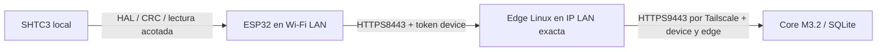

# M3.5 — ESP32 ↔ Edge ↔ Core

## Contratos existentes auditados

Fuentes reales: `components/https_client/https.c`, `connectivity_core/{snapshot,cycle}.c`,
`device_config/{parse,provision,store}.c`, `main/m2_main.c`,
`gateway/infrabadge_gateway/distributed/{api,core,edge,config}.py`.

| Interfaz existente | Límite y comportamiento |
| --- | --- |
| ESP32 GET `/api/v1/devices/{id}/status` | TLS1.2, CA/SAN/fechas; bearer individual; respuesta máxima2048B |
| Snapshot schema_version1 | Status,4 contadores,2 alertas; títulos24 y detalles28 caracteres; total nodos≤999 |
| UNKNOWN/OFFLINE | Wire conserva diferencia; decoder C los colapsa a la categoría visual OFFLINE |
| ETag | Tag SHA256 de64hex entre comillas; If-None-Match sólo con cache vigente;304 exige mismo tag y cache aún vigente |
| Core | Identidad device por sitios + credencial edge por dispositivos; scopes separados de reader/collector |
| Edge | Origen fijo HTTPS, host exacto8443, GET v1 exclusivamente; sin query, redirects, proxy ambiente ni cache persistente |
| Edge body | Hasta4096B; no implica que ESP32 acepte más de2048B |
| TTL/revisión | Core invalida por muestras/estado/sesión; edad sola no cambia bytes;200/304 no renuevan muestras |

El framebuffer diff y Power Manager siguen sin cambios. `main/m2_main.c` no
instala un menú multisitio ni lee SHTC3 en cada consulta normal; el driver existe
en HAL, pero eso no equivale a mostrar ambiente en el firmware instalado.

## Conectividad propuesta, sin despliegue

Preferir edge en la Raspberry central si su LAN alcanza al badge y tiene recursos,
para que la notebook móvil no sea dependencia permanente. Elegir máquina/IP/
interfaz/perfil y origen LAN mediante preflight posterior autorizado; no se
asume estado real de listeners, firewall o DNS por leer plantillas. Telemetría
9443 sigue privada y separada; el ESP32 no tiene Tailscale/MagicDNS.

### TLS, DNS y provisión

1. Nombre LAN estable bajo dominio controlado, registro A hacia IP LAN exacta;
   SAN DNS idéntico y cadena verificable. No usar una IP distinta con hostname
   falso ni depender sólo de `.local`/MagicDNS. En fixtures, `.test` no es DNS real.
2. Leaf nuevo por edge, claves separadas en Linux, permisos mínimos; CA pública
   en ESP32 y CA del Core en edge. Claves CA/leaf nunca en placa/Git/logs.
3. Edge añade su credencial a la del dispositivo; no copiar token reader o
   collector al badge ni dar al edge acceso a administración/ingestión.
4. Renovar leaf bajo la misma CA/SAN no debería exigir reprovisión del ESP32,
   pero comprobar fechas/cadena y continuidad con pruebas; rotar CA o cambiar
   nombre requiere provisión explícita y rollback, no TLS inseguro.
5. Config M3 dispone de base_url191 caracteres, PEM CA2048, token96; el JSON
   de provisión se limita a4096B. No asumir bundle de dos CA cabe: medir bytes
   antes de planificar superposición de confianza. Sin regenerar PKI ahora.
6. El firmware instalado puede confiar en otra CA/URL. Leer metadatos privados
   y confirmar artefactos bajo permiso; no asumir que la CA Core ya está en NVS.
7. UTC confiable se entrega por USB autorizado con entrada sin eco, no argv/logs.
   RTC externo2056 no inicializa TLS; lease1h y continuidad RTC deep sleep se
   conservan. Tras cold reset no se recupera UTC desde un timestamp NVS viejo.
8. Guard LAN cerrado por defecto, origen/interfaz/IP exactos, sin publicación
   wildcard/internet, sin tocar VPN/rutas globales. Se portarán protecciones de
   la propuesta M3.1 sólo tras revisar su alcance; no se fusiona PR5 por eso.

## Evolución necesaria para ocho vistas — RFC, no API implementada

Mantener v1 sin cambios para el firmware actual. No sobrecargar sus dos alertas,
agregar campos (decoder estricto) o tratar el inventario reader como API device.

Propuesta independiente: `/api/v2/devices/{id}/views/{view_id}`, sólo GET, ruta
allowlisted y origen fijo. **Hoy devuelve404; no está implementada ni servida.**
Capacidad opt-in por dispositivo, sites/nodes derivados sólo de su scope; sin
credenciales reader. Edge debe autorizar/revalidar esa ruta en código nuevo;
el edge M3.2 actual rechaza v2 y no se cambia aquí.

- Hasta16 vistas configuradas por dispositivo;8 páginas principales. Cada vista
  tiene payload≤2048B, una proyección acotada, schema_version2, device/view IDs,
  generación/expiración/revisión y estado explícitos. No inventario ilimitado.
- Listas con hasta3 filas/página; paginación mediante IDs de vista preautorizados,
  sin URL/query arbitraria, cursor libre o reenvío de headers administrativos.
- TTL nunca posterior al primer vencimiento de métricas; controles vacíos/
  caducados conservan TTL corto. ETag por vista incluye contenido y vigencia.
 304 no extiende expires_at; rechazar vista/ID equivocados, futuro o rollback.
- Catálogo/revisión de conjunto para no mezclar páginas de distintas sesiones;
  invalidar cache del conjunto al cambiar catálogo. El diseño exacto de esta
  coherencia debe fijarse antes del decoder C y sus tests de replay.
- TRABAJO vacío/deshabilitado: UNKNOWN/NO CONFIGURADO, cero nodos reales. No
  habilitar fuentes laborales por crear una página. No elegir sitios por Wi-Fi.
- Ambiente nace del SHTC3 del badge con CRC/timestamp/validez propios; no se
  envía al Core ni se confunde con temperatura de CPU. Telemetría de ambiente
  sería otra decisión de privacidad/API, fuera de esta fase.

`tests/m35/fixtures` usa **prototype_version0/synthetic=true**, formato local
de diseño. No se entrega a `ib_snapshot_decode` ni se anuncia como schema v2
final. Una futura implementación debe separar modelo recibido, política UI,
renderizado y transporte; cambios de firmware en commit distinto.

## Fallos y recuperación

Conservar backoff M3 acotado, Wi-Fi stop y deep sleep; sin reconectar en bucle.
Fallo Wi-Fi/DNS/TLS/HTTP: indicar consulta inválida y salud remota no verificada,
no declarar caídos todos los servidores. Un200 UNKNOWN por muestras ausentes es
diferente de503 del edge/Core. No reetiquetar cache histórica como actual.
Al recuperar:200 nuevo o304 sólo si cache vigente, render condicionado a bytes,
sin reintentos ilimitados, reprovisión o corrección automática de reloj.
El panel puede retener píxeles tras caducidad o corte; esa imagen no demuestra
actividad/frescura. Mostrar última muestra y vence al integrar; Power Manager
programa el siguiente evento antes de vencer, sin reloj gráfico continuo.
