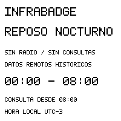

# Reposo nocturno configurable — implementación M3.6

M3.6 está instalado en CASA, con noche **deshabilitada**. Ejemplo público en
`deploy/m36/policy.example.json`: deshabilitado hasta provisión explícita;
horarios predeterminados00:00–08:00 y zona America/Argentina/Buenos_Aires.
`night_start`/`night_end` aceptan HH:MM estricto, diferentes entre sí. Se admiten
ventanas normales y cruzando medianoche, no ventana vacía/24h. Esta versión sólo
acepta esa zona IANA, implementada explícitamente UTC−3 sin DST. Tests contrastan
con zoneinfo para2026/2027/2030. Otras zonas se rechazan; un cambio legal de hora
requerirá revisar firmware, no se interpreta POSIX TZ arbitrario del usuario.

## Sin radio ni transferencias nocturnas

El coordinador se evalúa **antes** de Wi-Fi/HTTPS y durante navegación. Desde
cinco minutos antes del inicio puede mostrar un único aviso REPOSO NOCTURNO,
horario fijo y DATOS REMOTOS HISTORICOS. No mantiene métricas actuales toda la
noche. No dibuja si quedan<=180s hasta la ventana ni al entrar ya de noche: así
una entrada tardía conserva la imagen anterior. El margen180s cubre las cinco
esperas BUSY de hasta30s del driver actual más secuencias/transferencias; no se
inicia un nuevo refresco en la ventana. Un panel atascado falla con timeout,
no provoca reintentos de refresco nocturno. Framebuffer diff evita retransmitir el mismo aviso.

Durante reposo: no Wi-Fi, HTTPS, SHTC3 ni e-paper. Se mantiene el Power Manager y
el timer ESP32 validado, que admite hasta3600s por entrada: checkpoints internos
cada hora como máximo, **sin consultas/refrescos**, y último timer calculado
para el fin local08:00. No hay bucle de refresco residente. No se escribe una
alarma PCF85063 ni se cambian sus registros de hora; sólo se lee su contador.
Core, collectors y edges siguen normalmente: no hay comando remoto para pararlos.

BOOT/PWR mantienen wake y circuito: un pulso nocturno despierta MCU, comprueba
continuidad y vuelve a dormir sin red/panel; no abre navegación durante esa
ventana. Al salir, navegación vuelve a su comportamiento actual. Si un botón
queda sostenido, se espera su liberación hasta120s; después se rehúsa dormir,
sin radio ni reset automático. Es una limitación energética explícita, no una
modificación del latch/PWR. No se afirma que la imagen retenida pruebe sueño.

## Confianza horaria y salida acotada

La fecha2056 del PCF85063 NO se considera UTC y no se corrige. Antes de iniciar
el período se exige UTC confiable dentro del lease M2/M3 de3600s, a partir de
provisión física confiable o servidor HTTPS previamente validado. Se registra
en RTC del ESP32 un permiso con inicio UTC, fin fijo (<24h) y lectura relativa
PCF. El registro y el compañero de UI tienen CRC, configuración coincidente y
sólo se aceptan tras reset DEEPSLEEP. No se recupera este permiso desde NVS.

En cada checkpoint/manual wake, ambos relojes deben avanzar coherentemente
(diferencia<=60s respecto del inicio), sin STOP/OS/BCD inválido y sin exceder
fin+120s. La fecha PCF sólo aporta un delta, incluso si su año sigue2056.
No se rearma/mueve el fin por un despertar nocturno. Cold reset/pérdida RTC,
divergencia o lectura inválida cancelan el permiso: fallback CLOCK con sueños
acotados60–300s, sin Wi-Fi si UTC no es confiable. La inhibición programada sólo
es aplicable con tiempo válido; no se calcula un sueño largo con fecha inválida.
No se prolonga el lease global de M0–M3.5 ni se introduce NTP inseguro.

Al fin previsto, una única revalidación local de continuidad dual da una ventana
normal de una hora para autenticar TLS; se invalida cache/ETag antes de consultar.
Sólo después de TLS CA/SAN/fechas y renovación acotada con hora del Core se acepta
un snapshot nuevo. La comprobación local no se llama sincronización de red.
Si Wi-Fi/HTTPS falla, OFFLINE sin métricas actuales y backoff; si se pierde
confianza horaria, CLOCK. El PCF no se transforma en autoridad tras un reinicio.
Una futura fuente de tiempo autenticada adicional sería otra decisión de diseño.

## Energía y validación pendiente

Los checkpoints leen el PCF por el HAL existente y alimentan brevemente el rail
I2C compartido con ES8311. No se habilita audio. No se estimó ahorro/autonomía con
400mAh: medir durante un ensayo posterior con instrumento. Retención de imagen,
logs simulados o llamada de sleep no acreditan corriente real.

Tests de la aplicación C real con HAL simulado confirman aviso previo, ocho
checkpoints sin radio/consultas/transferencias, manual EXT1, salida08:00,
fallo Wi-Fi al final, cold boot sin UTC/con semilla fresca dentro de ventana y
RTC inválido. Tests puros cubren medianoche, ventana diurna, fin00:00, CRC,
saturación de plazos y dos relojes divergentes. Los tests de navegación y diff
M3.5 siguen activos. Referencia sintética, no fotografía:

Una única prueba física00:00–08:00 con hora real está preparada en
[CASA-STABLE](CASA-STABLE.md#una-noche-real-opcional). Requiere autorización para
una provisión IBPROV36 de la política, conservando binding CASA, Wi-Fi, CA, token,
URL e intervalos. No requiere reflashear ni un piloto corto previo. Sin saltos de
reloj productivo. No se activó durante este cierre ni se declara ahorro medido.
