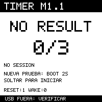
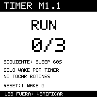
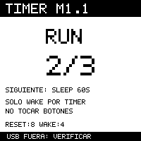
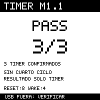
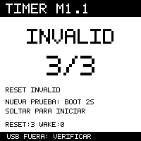

# M1.1 — diagnóstico de despertar autónomo por temporizador

## Estado y alcance

Este perfil temporal comprueba una secuencia de **tres deep sleeps de 60 segundos**
usando el temporizador interno del ESP32-S3. Está separado del perfil UI M1.
**M1.1 fue cargado con autorización el 17 de octubre de 2026.** Reemplazó
temporalmente M1. **Validación funcional con batería aprobada:** el operador confirmó
un RUN 0/3 nuevo y la secuencia 1/3 → 2/3 → PASS 3/3, sin USB ni intervención.
La compilación, los tests y las imágenes sintéticas no prueban funcionamiento con
batería ni autorizan otras cargas.

Base: Waveshare ESP32-S3-ePaper-1.54 **V2**, ESP-IDF **v5.5.5** en el commit de
`dependencies.lock.json`. No se añaden GPIO, dependencias, radios ni servicios.
Se reutilizan el HAL y el driver e-paper validados en M0 y el Power Manager de M1.

| Evidencia | Procedencia | Alcance |
| --- | --- | --- |
| Pantalla, botones, navegación, sleep y retorno timer/BOOT/PWR con USB | [Resultados M1](M1-PHYSICAL-RESULTS.md) | Validación funcional anterior; no demuestra autonomía |
| Encendido, BOOT y PWR sin USB | Observación comunicada por el operador para M1.1 | Confirmados por el usuario; sin nueva captura instrumental |
| LiPo AT 502535, 3,7 V, 400 mAh | Datos nominales comunicados por el usuario | No es una medición de capacidad ni de autonomía |
| 4,03 V en circuito abierto | Medición comunicada por el usuario | No es lectura ADC bajo carga, porcentaje de carga ni consumo |
| Tres retornos consecutivos por timer sólo con batería | Secuencia nueva observada y confirmada por el operador | Validación funcional aprobada; sin medición de corriente o tiempos individuales |

El RTC externo PCF85063 avanza con fecha incorrecta de 2056. Sigue **no
sincronizado**: no se lee para decidir el resultado, no se corrige y no se usa NTP.
Ese RTC es distinto del temporizador interno que despierta al ESP32.

## Diseño y garantías del firmware

`timer_diag` contiene modelo, validación y renderizado portables. La aplicación
`main/timer_diag_main.c` consulta causas IDF y orquesta HAL, panel y Power Manager.
El perfil se selecciona con `CONFIG_IB_M11_TIMER_DIAG`; su build independiente está
en `build-m11/timer`. El código de la aplicación UI M1 no se cambia.

La extensión `ib_power_sleep_mode(seconds, button_wakeup)` permite pedir timer
exclusivo. La función M1 existente `ib_power_sleep(seconds)` conserva su interfaz y
solicita los mismos despertares por botones que antes. El HAL existente deshabilita
primero todas las fuentes, habilita el timer y sólo habilita EXT1 si se solicita.
M1.1 siempre pide **60 segundos y `button_wakeup=false`**.

Un registro de 28 bytes en `RTC_NOINIT_ATTR` guarda versión, contador, fase,
bandera de sleep pendiente, motivo de fallo y CRC32. No se escribe flash/NVS.
El CRC detecta corrupción accidental; no es una firma criptográfica.

```text
NO RESULT / INVALID
    └─ BOOT >=2 s y soltar, con PWR suelto ─> RUN 0/3 (imagen nueva)
RUN n/3 ─> armar registro RTC ─> deep sleep 60 s, sólo timer
    ├─ reset DEEPSLEEP + wake TIMER + registro válido y armado
    │      └─ contador n+1; mostrar 1/3, 2/3 o PASS 3/3
    └─ otra causa / registro inválido / botón retenido ─> INVALID
PASS 3/3 ─> fin de app_main; sin cuarto sleep ni reinicio automático
```

El único incremento está después de comprobar todas estas condiciones:

1. Registro con versión, CRC, rangos y fase coherentes.
2. Reset `ESP_RST_DEEPSLEEP`, no encendido ni reinicio de software/brownout/watchdog.
3. Fase RUNNING con una entrada a sleep pendiente.
4. Causa `ESP_SLEEP_WAKEUP_TIMER`, no EXT0/EXT1 ni otra fuente.
5. BOOT y PWR sueltos al comprobar el retorno.

La bandera pendiente se consume al incrementar. Procesar de nuevo el mismo
retorno no permite otro incremento. Después de 3/3 no se puede rearmar otro sleep.
Un fallo de HAL, panel o preparación de sleep invalida la ejecución y no continúa.
BOOT y PWR no están habilitados como fuentes de wake; si PWR provoca un cambio de
alimentación, eso tampoco se cuenta como timer. No pulsarlos durante los ciclos.

Un reinicio inesperado con registro retenido invalida la secuencia, conservando el
contador parcial como diagnóstico. Un fallo no inicia otra secuencia por sí solo.
Un nuevo arranque en READY/FAILED permite empezar explícitamente desde cero con
BOOT. El registro sin inicializador permite observar reinicios calientes, pero
**un corte completo puede perder toda RTC RAM**: sin un diario persistente no se
puede reconstruir la secuencia anterior. Se muestra NO RESULT o INVALID, nunca se
recupera un aprobado perdido. Un primer arranque después de flashear puede mostrar
INVALID / RTC INVALID por no tener un registro válido; admite el mismo inicio manual.

Referencias oficiales fijadas: [modos de reposo ESP-IDF 5.5.5 para ESP32-S3](https://docs.espressif.com/projects/esp-idf/en/v5.5.5/esp32s3/api-reference/system/sleep_modes.html)
y [atributos RTC de esa versión](https://github.com/espressif/esp-idf/blob/v5.5.5/components/esp_common/include/esp_attr.h).

## Pantallas sintéticas y tests

El generador usa el mismo modelo y renderizador C del firmware, sin una biblioteca
gráfica adicional. Los PNG siguientes son **simulaciones**, incluido el PASS; no
son evidencia de una placa ni de una prueba física aprobada.

| Preparado | Inicio manual | Primer retorno |
| --- | --- | --- |
|  |  |  |

| Segundo retorno | Resultado simulado | Secuencia invalidada |
| --- | --- | --- |
|  |  |  |

Compilar sin acceder al dispositivo, desde la carpeta del proyecto:

```bash
bash tools/build-timer.sh --all  # tres M0, UI M1 y diagnóstico M1.1, más tests
bash tools/build-timer.sh        # sólo nuevo perfil y tests
```

Dentro del entorno IDF activado:

```bash
bash tools/test.sh
IB_SANITIZE=1 bash tools/test.sh
python3 tools/simulate_timer.py --check
python3 tools/simulate_timer.py --output results/m11-preview
```

Las pruebas ejercitan la matriz reset/wake, registro desarmado, corrupción de cada
bit, reinicios intermedios, pulsaciones, CRC, desbordamiento de tiempo de entrada y
límites del framebuffer. Otra prueba ejecuta la **entrada real de la aplicación**
con HAL/SDK simulados: exige tres llamadas al Power Manager con 60 s y botones
deshabilitados, frames 0/3→1/3→2/3→3/3 y ninguna cuarta llamada. Los sanitizadores
comprueban acceso a memoria y comportamiento indefinido en las pruebas nativas.
La verificación del ELF exige el registro de 28 bytes en una sección RTC no
inicializada NOBITS. Nada de esto sustituye comprobar reset/wake en silicio.

Validación local completada el **17 de octubre de 2026**, en el `iot-dev` existente
y sin puertos ni cargas. El supervisor terminó con `status=passed`, cuatro comandos
con salida 0 y fuentes estables en el intento 4. Se corrigió una advertencia por
`setjmp/longjmp` del test nativo; otro intento detectó referencias visuales que
habían cambiado durante el desarrollo. La ejecución final valida las fuentes y
las seis referencias definitivas.

| Comprobación ejecutada | Resultado |
| --- | --- |
| Tests Python existentes (8 casos) y C de M0/M1 | Pasaron |
| Máquina de estados M1.1: reset/wake, tres ciclos, 224 corrupciones de un bit, inicio manual y render | Pasó, con datos simulados |
| Entrada real del diagnóstico con SDK/HAL simulados | Pasó: frames 0/1/2/3 y exactamente tres llamadas timer-only |
| AddressSanitizer + UndefinedBehaviorSanitizer | Pasaron en toda la suite nativa |
| Referencias visuales | Seis pares PBM/PNG comparados; revisión visual sin recortes |
| Compilaciones y verificación de cinco perfiles | Pasaron; tamaños a continuación |
| Registro del diagnóstico en ELF Xtensa | 28 bytes en `.rtc_noinit`, tipo SHT_NOBITS |
| Actionlint y revisión de espacios del diff | Pasaron |
| Workflow ampliado en GitHub | En ese cierre local aún no ejecutado; para la revisión publicada, consultar checks del PR #1 |
| Carga física M1.1 y secuencia con batería | Carga autorizada completada; tres retornos confirmados por el operador |

| Perfil | Aplicación compilada (bytes) |
| --- | ---: |
| M0 display | 187.824 |
| M0 sensors | 185.280 |
| M0 sleep | 197.648 |
| M1 UI reconstruido | 214.256 |
| M1.1 timer | 213.104 |

El M1 reconstruido tiene hashes nuevos por la extensión del Power Manager; no es
el binario de 214.128 bytes validado físicamente antes. Sus regresiones pasan, pero
no se le atribuye una nueva validación física ni se carga en la placa. El HAL, la
aplicación UI M1 y el protocolo de panel permanecen sin cambios de fuentes.

Hashes públicos de los cinco builds y alcance de las comprobaciones:
[m11-build-manifest.json](m11-build-manifest.json). Huella de las fuentes comprobadas:
`2a9d84a25931a0c45e9cfe3d094b946397cad727513b1c80a20208432978e229`.
El manifiesto explica el alcance de esa huella; no incluye documentación ni fixtures.
Los fixtures sí se comprobaron por comparación visual binaria/de píxeles.

Resultados locales sin versionar:
`results/m11-supervised-20261017T201126Z-91f51cra/`,
`results/m0-build-20261017T201345Z-YXNxSD/`,
`results/m1-build-20261017T201349Z-bHFupY/` y
`results/m11-build-20261017T201352Z-4yynIW/`. No contienen una captura nueva de hardware;
los logs físicos anteriores y el respaldo privado siguen excluidos de Git/CI.

## Carga controlada — requiere autorización nueva

### Sesión autorizada el 17 de octubre de 2026

El usuario indicó «avanza con la prueba fisica», después de revisar el perfil y su
procedimiento. Esto autoriza **una carga controlada del M1.1 aprobado**, seguida de
las observaciones con batería. No autoriza repetir cargas automáticamente, cambiar
el diagnóstico ni restaurar M1/fábrica al terminar. **La carga y la validación
funcional de los tres retornos con batería están cerradas.**

Se preparó un auxiliar interactivo fuera del repositorio. Antes de iniciar se
ejecutaron sus tests sin hardware y la comprobación de fuentes, binarios, sección
RTC y backup privado: pasaron. El auxiliar conserva los artefactos aprobados en el
directorio local de esa sesión, carga una vez, no abre un monitor serie y pide
retirar físicamente USB antes del inicio manual. Registra por separado las lecturas
de pantalla y las confirmaciones del operador. Sus marcas de tiempo corresponden
a las respuestas humanas, no a medidas instrumentales del tiempo dormido. El
estado `diagnostic_collected` deja el veredicto pendiente de revisión.

La sesión local `results/m11-physical-20261017T201841Z-62tkzs1t/` completó la carga
entre 17:18:42 y 17:18:58 (Argentina, UTC−3). Esptool terminó con salida 0 y tres
mensajes de verificación de hash. Se contrastaron las copias de los cuatro
artefactos (ELF y tres binarios) con el manifiesto aprobado. El respaldo privado
también pasó su comprobación; no se copió ni publicó su contenido o hash.

El auxiliar se detuvo con `partial` al responderse «no» a la confirmación de la
pantalla inicial. El operador aclaró después en el chat que veía **INVALID 0/3**:
es un estado inicial previsto antes de armar la primera secuencia. Esta respuesta
no demuestra un fallo de hardware ni confirma todavía un despertar. El registro
original se conserva sin modificar. Se continúa manualmente con el mismo firmware,
sin nueva carga, monitor ni reset solicitado, en
`results/m11-physical-resume-20261017T202047Z-jzy_36cl/`. Las observaciones de esta
continuación se reciben por el chat y se distinguen de capturas instrumentales.

### Procedimiento general

Este procedimiento queda como referencia para futuras sesiones; **no autoriza
otra carga**. Actualmente la placa conserva M1.1. Cualquier nueva escritura debe
revisarse y autorizarse expresamente.

1. Conservar y verificar localmente el backup privado de fábrica de 8 MiB según
   [FLASHING.md](FLASHING.md). Conservar también los artefactos del M1 validado y su
   manifiesto. No publicar respaldo, identificadores ni logs crudos de la placa.
2. Completar compilación/tests y revisar el manifiesto `timer.json` del build
   elegido, incluidos los hashes de aplicación, bootloader y particiones.
3. **Obtener autorización explícita para cargar este diagnóstico.** Recién después,
   conectar USB estable y verificar placa V2, puerto y ausencia de otros monitores.
4. Dentro del entorno IDF, desde la raíz, verificar sin reconstruir y comparar los
   hashes con el build aprobado:

```bash
python3 tools/verify_build.py --profile timer --build build-m11/timer \
  --output /tmp/infrabadge-timer-preflash.json
```

5. Sólo con esa autorización y puerto confirmado, usar los tres artefactos del
   mismo build. El comando siguiente **escribe firmware**; no ejecutarlo como test:

```bash
: "${ESPPORT:?Definir ESPPORT con el puerto verificado de la placa}"
test -c "$ESPPORT" && test -r "$ESPPORT" && test -w "$ESPPORT"
cd build-m11/timer
python -m esptool --chip esp32s3 --port "$ESPPORT" --baud 115200 \
  --before default_reset --after hard_reset write_flash @flash_args
```

Esto escribe los sectores de bootloader/tabla/aplicación indicados en `flash_args`;
no es un borrado completo. No ejecutar `erase_flash`, escrituras de eFuses ni
cambios de Secure Boot/Flash Encryption. Detenerse ante avisos de seguridad o
inconsistencia de objetivo, sin forzar la herramienta.

Para diagnóstico previo a la prueba, el monitor se puede abrir sin reset desde la
raíz: `idf.py -B build-m11/timer -p "$ESPPORT" monitor --no-reset`. Cerrarlo y retirar
USB antes de iniciar la secuencia autónoma. El firmware espera una acción manual;
la carga o la desaparición de USB no inician ni aprueban la prueba.

## Procedimiento físico exclusivamente con batería

1. Revisar físicamente el estado, conector y polaridad de la batería conforme a la
   placa. Con M1.1 autorizado y cargado, esperar la pantalla inicial. No modificar
   cables con cortocircuitos ni emplear una batería dañada.
2. Conectar la batería según el procedimiento habitual y **retirar totalmente el
   cable USB**. No basta cerrar el monitor. Confirmar visualmente la fuente real;
   el firmware no detecta ni certifica que USB esté ausente.
3. Con ambos botones sueltos, mantener BOOT al menos dos segundos y soltarlo.
   Esperar el nuevo frame **RUN 0/3** (incluye una pausa de cinco segundos antes
   del refresco). Si se acaba de encender, soltar ambos primero. Un botón retenido
   al arrancar no inicia la prueba. PWR no es el botón de inicio.
4. Registrar hora/cronómetro y una foto de ese **0/3 nuevo**. No aceptar un PASS
   que ya estaba dibujado: la e-paper retiene imágenes aunque no haya alimentación.
5. Dejar la placa quieta, sin botones, USB ni resets. Observar y fotografiar cada
   transición nueva: **1/3, 2/3 y finalmente PASS 3/3**. Cada sleep está configurado
   a 60 s; el tiempo entre imágenes añade arranque y refresco completo del panel.
   No presentar ese intervalo como calibración exacta del temporizador.
6. Para los retornos válidos, la pantalla debe indicar reset **8** y wake **4**
   (DEEPSLEEP y TIMER en el SDK fijado). Anotar los valores, tiempos y observaciones.
   INVALID, NO RESULT, un nuevo 0/3, corte de alimentación o cualquier intervención
   que rompa la continuidad invalida **esa ejecución**. No sumar ciclos de intentos
   distintos. Una nueva prueba exige inicio manual y un nuevo 0/3.
7. PASS sólo se acepta físicamente si se observó toda la progresión sin USB y sin
   intervención. Guardar las fotos y el registro antes de reconectar. Tras 3/3 el
   código termina `app_main` sin programar un cuarto sleep; puede dejarse más de un
   minuto para observar estabilidad, pero una imagen inmóvil por sí sola no prueba
   ausencia de actividad, consumo ni estado del microcontrolador.
8. Una reconexión posterior de USB puede reiniciar el dispositivo e invalidar el
   registro retenido. Eso no reemplaza ni amplía las observaciones guardadas.
   Detener la sesión y comunicar resultados; no restaurar ni flashear por cuenta
   del procedimiento.

El perfil conserva el circuito de batería mediante el HAL. Al terminar deja el
resultado visible y no vuelve a dormir: **no es un firmware de bajo consumo final**.
Ni la imagen retenida ni la desconexión USB miden consumo o demuestran deep sleep.
Corriente, capacidad efectiva, ADC bajo carga, autonomía y precisión del timer
requieren pruebas e instrumentos separados.

## Cierre de validación física — 17 de octubre de 2026

**Resultado: PASS funcional observado por el operador, exclusivamente con batería.**

Firmware cargado: fuentes `a1c7294`, aplicación de **213.104 bytes**, SHA-256
`eed151751d100137432cebfe44a70b9e4d1bd2d067b2380a1c45c0d6fb51711b`.
Se utilizó el build aprobado en `m11-build-manifest.json`, sin recompilarlo ni
cargarlo nuevamente para continuar.

El usuario comunicó que observó la secuencia indicada y los textos **3 TIMER
CONFIRMADOS**, **SIN CUARTO CICLO**, **RESULTADO SOLO TIMER**, **RESET:8 / WAKE:4**
y **USB FUERA: VERIFICAR**. Confirmó expresamente haber observado desde un
**RUN 0/3 nuevo** hasta **PASS 3/3**, sólo con batería, con el cable USB completamente
retirado y sin pulsaciones, reinicios ni cortes de alimentación desde ese 0/3.

La progresión nueva confirma actividad entre ciclos; el resultado no se basa en
una imagen PASS previamente retenida. El firmware sólo aumenta el contador con
registro RTC íntegro y armado, reset de deep sleep y causa TIMER. El operador
comunicó los valores 8/4 al describir el resultado; no se aportó un registro
independiente de causas o tiempos por ciclo. La fuente de alimentación y la
continuidad se basan en su confirmación física, no en detección de USB por firmware.

| Paso | Imagen nueva | Reset / wake | Tiempo observado | USB físicamente ausente | Evidencia / observación |
| --- | --- | --- | --- | --- | --- |
| Inicio manual | RUN 0/3 nuevo confirmado | No registrado | No medido | Confirmado | Inicio nuevo tras BOOT y liberación |
| Ciclo 1 | 1/3 observado | 8 / 4 exigidos por firmware; sin lectura separada aportada | No medido | Confirmado | Continuidad confirmada por el operador |
| Ciclo 2 | 2/3 observado | 8 / 4 exigidos por firmware; sin lectura separada aportada | No medido | Confirmado | Continuidad confirmada por el operador |
| Ciclo 3 | PASS 3/3 observado | 8 / 4 comunicados | No medido | Confirmado | Resultado terminal comunicado |

**USB FUERA: VERIFICAR es un recordatorio fijo**, no una lectura de presencia USB.
La confirmación humana de cable retirado es la evidencia para ese punto.

No se programa un cuarto sleep en el código y la prueba nativa de la entrada real
exige exactamente tres llamadas al Power Manager. El usuario observó el resultado
terminal. Una pantalla inmóvil no demuestra por sí sola ausencia de actividad del
microcontrolador ni mide consumo; no se atribuye esa medición a esta prueba.

Las respuestas y la revisión están guardadas en
`results/m11-physical-resume-20261017T202047Z-jzy_36cl/` (`operator-report.json` y
`result.json`, veredicto `passed_operator_observed`). La sesión original de carga
con `partial` se conserva intacta: la continuación la complementa. No hubo monitor
USB durante los ciclos, fotos aportadas ni registro instrumental de tiempos.
No se repitió la carga, no se solicitó reset y no se restauró M1 ni fábrica.

El aprobado corresponde a **tres retornos funcionales consecutivos por temporizador
con la LiPo AT 502535**. Corriente de la placa, autonomía, capacidad efectiva,
ADC bajo carga y precisión temporal siguen pendientes de medición. El RTC externo
permanece no sincronizado; no se modificó su fecha. La placa conserva el diagnóstico
M1.1 instalado, que deja de programar sleep al terminar.

## Volver a M1 o fábrica

La restauración es otra escritura y requiere autorización explícita. Para M1,
verificar los artefactos guardados frente a `m1-build-manifest.json` y seguir
[el procedimiento M1](M1-PHYSICAL.md), sin mezclar binarios con el build M1.1.
Si se reconstruye M1 desde esta rama, cambia el conjunto de fuentes: revisar su
nuevo manifiesto y autorizar esos artefactos expresamente. Para fábrica usar sólo
el respaldo privado y [el procedimiento de rollback](FLASHING.md). No se ejecuta
ninguna restauración como parte de tests, compilación o esta preparación.
