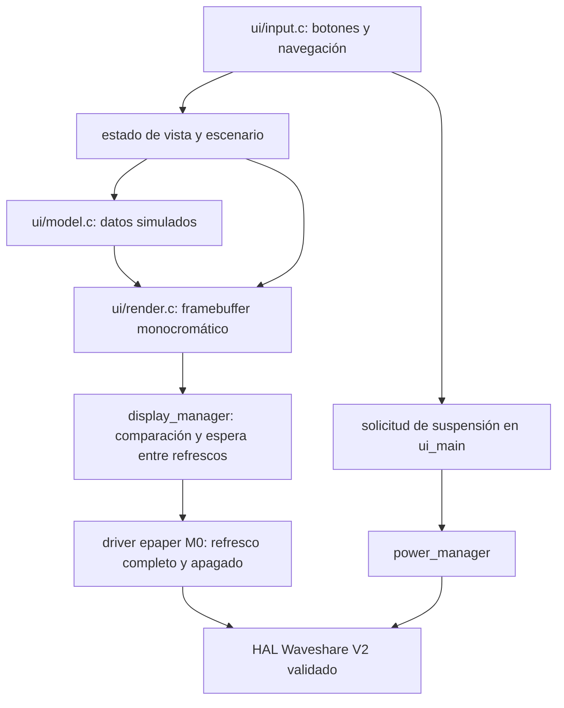

# M1 — arquitectura y decisiones de interfaz

M1 añade una interfaz offline de 200 × 200 píxeles sobre la Waveshare V2. Parte del
M0 validado físicamente, conservado en el commit local `910bf9f`. Su desarrollo está
en `feat/m1-ui`. No incorpora red, servicios externos, credenciales ni librerías gráficas.

## Capas



- **Modelo:** estado de infraestructura HEALTHY/WARNING/CRITICAL/OFFLINE, conteos,
  hasta dos alertas y diagnóstico simulado. No conoce píxeles ni GPIO.
- **Renderizado:** C estándar, framebuffer de 5.000 bytes, MSB-first, blanco=1;
  fuente original 5×7, escala entera 1/2/3 e iconos propios. No reserva heap.
  Datos fuera de los límites del contrato se rechazan antes de modificar el frame.
- **Entrada:** dos botones con debounce de 40 ms, eventos al soltar, sin autorepetición.
  Usa tiempo monotónico de 32 bits y diferencias seguras ante rollover.
- **Display manager:** conserva 5.000 bytes de la última transferencia correcta.
  Compara todos los bytes, sin colisiones de hash. Descarta frames iguales y agrupa
  cambios pendientes. Un fallo invalida la copia; la aplicación se detiene y no
  reintenta continuamente un panel de estado incierto.
- **Power manager:** aplica el HAL existente y entra en deep sleep. La UI solicita
  suspensión, pero no configura registros de alimentación ni fuentes de wake.
- **Orquestación:** `main/ui_main.c` selecciona el modelo/vista y conecta los módulos.
  `main/main.c` M0 y la implementación HAL/protocolo e-paper permanecen sin cambios.
  La aclaración del contrato público de epaper permite llamadas serializadas.
  Las dependencias CMake se declaran sin condicionar por CONFIG: ESP-IDF las evalúa
  antes de cargar Kconfig. El archivo de entrada sí se selecciona por perfil.
  Así los módulos UI también se compilan en las regresiones M0; el linker descarta
  el código sin referencias. El verificador comprueba por símbolos que M0 no enlaza la UI.
  Referencia: [build system ESP-IDF 5.5.5](https://docs.espressif.com/projects/esp-idf/en/v5.5.5/esp32s3/api-guides/build-system.html#component-requirements).

## Pantallas

| Vista | Contenido |
| --- | --- |
| Resumen | Estado con icono y texto, nodos, OK, fallos, avisos y datos ausentes |
| Alertas | Hasta dos alertas legibles; HEALTHY muestra SIN ALERTAS; OFFLINE no infiere salud |
| Diagnóstico | Placa/SDK, tensión estimada, temperatura/humedad, panel y reloj no confiable |

Cada vista identifica **SIM**, número de página y **RELOJ NO SINCRONIZADO**. El
estado se diferencia por forma y texto: check, triángulo, cruz y enlace interrumpido;
no depende de color, sombreado o animación. Los títulos principales usan 14 píxeles
de alto; los conteos, 21; los detalles, 7. La legibilidad física de M1 sigue pendiente.

Todos los datos de infraestructura **y diagnóstico** son simulados, incluidos
batería y SHTC3. Los valores de ejemplo no son nuevas mediciones. M1 no consulta ni
escribe el calendario del RTC. La validez de BCD/OS/STOP observada en M0 no demuestra
sincronización: la fecha real incorrecta de 2056 no se utiliza ni se muestra como hora.
No hay NTP ni timestamps de pared inventados. El renderizador M1 rechaza modelos
que pretendan reloj sincronizado o datos reales: ese contrato debe ampliarse
expresamente cuando exista una fuente válida en otra iteración.

## Navegación y energía

| Acción despierto | Efecto |
| --- | --- |
| BOOT, pulsar y soltar | Resumen → alertas → diagnóstico → resumen |
| PWR, pulsar y soltar antes de 1,2 s | HEALTHY → WARNING → CRITICAL → OFFLINE → HEALTHY |
| PWR, mantener al menos 1,2 s y soltar | Solicitar deep sleep; no cambia el escenario |
| BOOT y PWR cortos juntos | Cambian vista y escenario; una petición de sleep tiene prioridad |

Una pulsación presente al arrancar o despertar se ignora hasta soltarla. Se conserva
vista/escenario en RTC RAM sólo tras un despertar real de deep sleep y una firma
válida. No se guardan en flash. Un reinicio normal vuelve al resumen HEALTHY.

Se usa únicamente el refresco completo M0. No se presupone compatibilidad ni se
programa un modo parcial del panel. El espaciado elegido es **5 s después de terminar
la transferencia/refresco**, pendiente de validar como experiencia de uso y frente
al panel real; no se presenta como un intervalo certificado por el fabricante.
Los cambios durante esa espera se agrupan y sólo se envía el último frame deseado.
Volver al frame ya mostrado cancela la actualización pendiente. Sin eventos no se
renderiza ni se transmite de nuevo. El panel se duerme y apaga tras cada envío.

La lectura de botones cada 20 ms deja dormir la tarea entre muestras; la CPU sigue
despierta. Es una decisión para reutilizar el HAL M0 sin añadir interrupciones. No
es una medición ni promesa de bajo consumo. SPI/BUSY son síncronos: una pulsación
completa durante un refresco puede perderse. Esperar el fin del refresco para navegar.

La suspensión es manual. Se rechaza si hay imagen pendiente, error de display o un
botón físico aún pulsado. El HAL conserva alimentación de batería y panel apagado.
Por defecto se configura timer de 60 s, ajustable por Kconfig, y wake por BOOT/PWR.
Al despertar se restaura la selección y se hace un refresco completo porque la copia
RAM del display ya no se considera válida. No se entra automáticamente otra vez en sleep.

**Dormido no hay navegación:** los botones sólo solicitan despertar por nivel bajo,
no cuentan páginas ni garantizan conservar una pulsación. Es necesario soltar y
pulsar de nuevo para navegar. USB puede desaparecer; la imagen e-paper permanece
congelada y no indica que la CPU esté despierta. El circuito PWR también tiene efecto
eléctrico, y BOOT es un pin de arranque: no mantenerlo durante un reset normal.
Wake por botones y operación sólo con batería requieren validación M1 específica.

## Simulador y referencias

`tools/simulate_ui.py` compila el modelo y renderizador C del firmware con el
compilador nativo. Produce 12 combinaciones de vista/estado en PBM y PNG monocromático,
además de una galería HTML offline con botones. No replica el renderizado en Python
ni simula rebotes, tiempo de BUSY, señal SPI o consumo. La galería cambia imágenes;
la lógica de entrada C se valida con tests nativos.

```bash
# Dentro de iot-dev, o con compilador C nativo disponible:
python3 tools/simulate_ui.py
python3 tools/simulate_ui.py --check
# Sólo después de revisar una modificación visual intencional:
python3 tools/generate_ui_font.py
python3 tools/simulate_ui.py --update
```

Abrir `docs/ui/index.html` en un navegador, o la copia `results/m1-preview/index.html`.
Las referencias están en `docs/ui/*.png` y `tests/fixtures/ui/*.pbm`. El test visual
compara los píxeles descomprimidos y los 5.000 bytes PBM, no la compresión zlib.
Las capturas son simulaciones; no deben presentarse como fotos de la placa.
